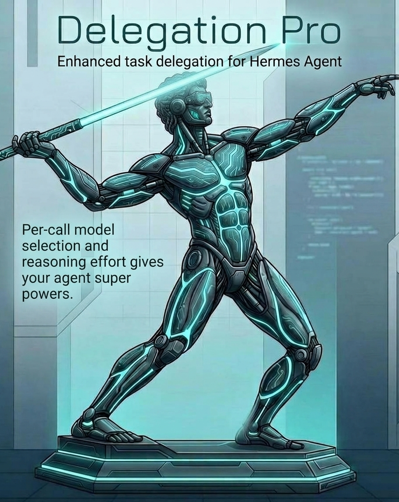

# hermes-plugin-delegation-pro



Enhanced task delegation for Hermes Agent: per-call **model selection** (tiered)
and per-call **reasoning_effort**, launched through the **public subagent
lifecycle API** (`ctx.subagent_lifecycle`, Hermes PR #140727+) — no core module
is patched.

Upstream declined exposing these knobs on `delegate_task` itself
(NousResearch/hermes-agent#56891); with the lifecycle API they arrive through
the documented plugin surface instead.

## Install

```bash
hermes plugins install rriggs/hermes-plugin-delegation-pro
hermes plugins enable delegation-pro
```

Requires a Hermes build with `ctx.subagent_lifecycle` (PR #140727 or later).
Each profile needs its own install (sub-profiles do not inherit the default
profile's plugins).

## Configuration

Add a `delegation_pro` section to your profile's `config.yaml`:

```yaml
delegation_pro:
  default_tier: medium
  tiers:
    small:
      provider: openrouter
      model: inclusionai/ling-3.1-flash
      reasoning_effort: none
      when: "trivial lookups, file reads, greps, mechanical edits"
    medium:
      provider: openrouter
      model: deepseek/deepseek-v4.1-flash
      when: "default delegation: implementation, research, summaries"
    large:
      provider: hyper
      model: glm-5.3
      reasoning_effort: high
      when: "reviews, planning, debugging loops, schema design"
```

- `model` — exact model id the child runs on; `provider` — the provider that
  serves it (precedence: request > `delegation` config > parent). Set BOTH per
  tier, matching the stock `delegation` config section (`model:` + `provider:`
  as separate keys). A slash in the model id is part of the id
  (`deepseek/deepseek-v4.1-flash`), never a provider prefix. Omit `provider`
  to inherit. Use LIVE model ids; if the provider retires a tag (404/410),
  launch fails loudly rather than falling back.
- Optional per-tier: `reasoning_effort` (`none` or `false` disables thinking;
  any standard level pins it), `when` — surfaced in the tool schema so the
  agent picks tiers by description, not by hardcoding.
- `default_tier` — used when the tool call omits `tier`.

## Tool

`delegate_task_pro` launches **one child per call** with:

- `goal` — what the child should accomplish (required)
- `context` — background the child needs
- `tier` — model tier from config (default: `default_tier`)
- `model` — explicit model id escape hatch, wins over tier
- `reasoning_effort` — per-call level, wins over the tier's level; `none`
  explicitly disables thinking

The call resolves the tier, builds a `SubagentLaunchRequest` (goal, context,
model, provider, reasoning_effort) and launches it via
`ctx.subagent_lifecycle.launch()`; the tool then waits for the child's
terminal state and returns its final summary. `reasoning_effort` is normalized
by Hermes' canonical parser; `False`/`"none"` are explicit disables and an
invalid value fails the launch with a clear error *before* any child is built.

The plugin also registers a short system-prompt section steering the agent to
`delegate_task_pro` for tier-routed delegations.

## Limits of the lifecycle surface (v2)

The lifecycle API launches one child per request and returns when it
terminates. The stock `delegate_task` surface that cannot be honored there is
**not advertised and rejected with a specific error**, never silently dropped:

| Stock feature | delegate_task_pro | Alternative |
|---|---|---|
| Batched `tasks` | rejected — one child per call | call once per task, or `delegate_task` |
| `output_schema` | rejected | `delegate_task` |
| `images` | rejected (put file paths in `context`) | `delegate_task` |
| `action=list/steer/stop` | rejected (`spawn` is implicit) | `delegate_task` |
| Background delegation | not offered — the call waits for the child | `delegate_task` |
| Per-launch timeout | not offered (children are bounded by `delegation.child_timeout_seconds`) | config |

One route per call, so a batch of separate calls may use different tiers.

## Behavior and safety

- Fail-safe: an unknown tier warns and proceeds on the stock route
  (delegation config > parent); the delegation is never lost.
- Launch errors (no active parent session, unresolvable provider, invalid
  reasoning effort) surface as clear tool errors — never a silent degrade.
- Child summaries are self-reports: verify external side effects yourself.
- Upstream drift is caught by the plugin's `test_drift.py` canaries
  (lifecycle request fields, PluginContext facade, inline-executor table,
  and a behavioral canary proving no delegation-config loader is touched).
- The tool keeps its sequential-tool-deadline exemption (an additive frozenset
  extension, mirroring the stock `delegate_task` exemption) so a long child is
  not abandoned by the generic ~420s tool timeout while the call waits on it.
- No core overrides: the v1 `tools.delegate_tool._load_config` monkeypatch is
  gone; `hermes plugins validate` no longer flags a core rebind for it, so the
  catalog-admission blocker is removed.

MIT. See LICENSE.